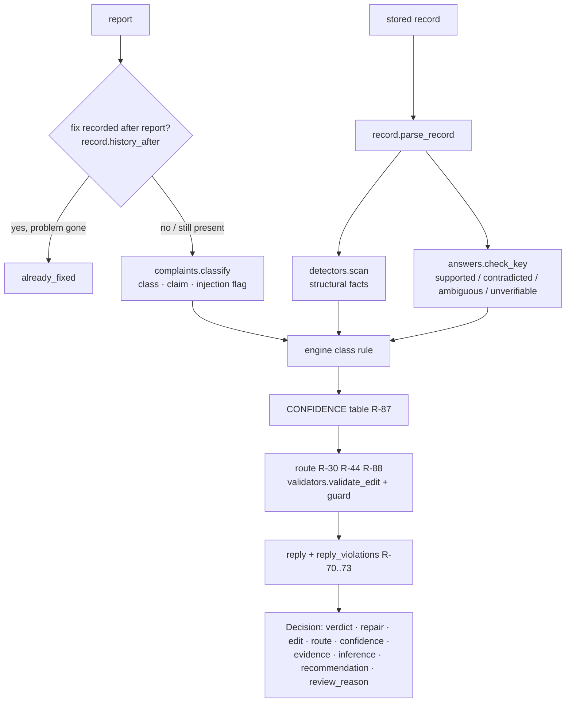
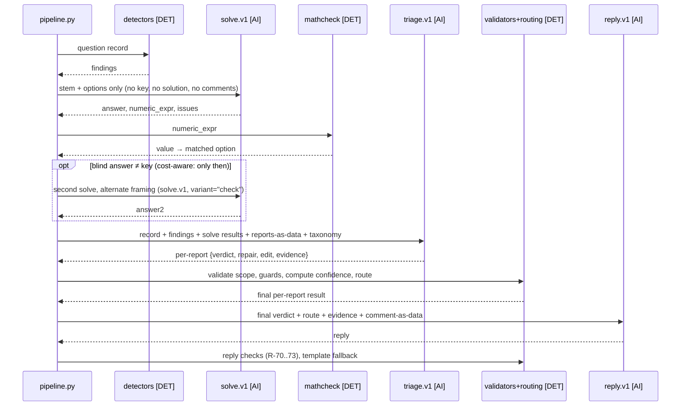

# AI Engine

> **Status (Phase 4, 2026-11-11):** the **rules-only engine is implemented** (§0) and produced the committed `results.json`. The LLM stages (§1–§10) are designed but **not implemented**: no provider or budget is confirmed (ADR-017), and the prompts in PROMPTS.md have never been run.

## 0. Rules-only engine (implemented)

| Module | What it does |
|---|---|
| `triage/complaints.py` | Closed set of complaint classes (English + Hinglish patterns), claimed answer, injection heuristics. The comment is only pattern-matched, never followed. |
| `triage/detectors.py` | Structural facts (option count/blank/duplicate, malformed key, LaTeX and `&` leaks, exam tag, figure without image, orphan solution fragment, inconsistent arithmetic, self-contradicting statements, single-letter near-miss spellings, unit-text mismatch). Also `foreign_literals` and `chapter_overlap` for specific complaints. |
| `triage/mathcheck.py` | Safe AST evaluator. Re-evaluates `lhs = rhs` steps: closed numeric pairs are compared, and same-variable symbolic pairs are checked as identities at seeded random points (a failed identity is neutral, because it may be an equation). Also solves integer targets from the record's own equations. |
| `triage/answers.py` | Key check from the record (signals in RULES R-87), claim placement, student correctness (R-89). |
| `triage/engine.py` | Class rules, calibration, routing, truthful replies, bonus findings. No report or question IDs appear in the code (a test enforces this). |
| `triage/validators.py` | Edit validity (R-10 to R-14) and the R-31/33/34/35 guards. |
| `triage/output.py` | Strict schemas for `results.json` and the bonus file, deterministic writers. |
| `services/triage_store.py` | Persists runs, results, proposed repairs (deduplicated per R-61), case statuses and audit events. Never applies anything. |

**What rules-only mode can and cannot do.**
- **Can:** verify a key against the record's own worked solution, as for R004, R005, the LCR question, R016 and R032/R033 (with unit and multiplier handling).
- **Cannot:** judge physics or biology truth independently. Recall disputes (R035) stay `unverifiable` and go to faculty. R034 is reached through *self-contradiction* evidence, not by evaluating the physics. A wrong solution that agrees with a wrong key would pass.
- **Hence:** an answer-key change never auto-applies (R-40), and every key-based confidence is capped at 0.70.

The engine is three narrow LLM calls wrapped in deterministic code. The LLM does the work only a model can do: solve a physics problem, read Hinglish, judge whether a solution belongs to a question, and write a kind reply. Code does everything that must never be wrong: enums, field scope, find/replace safety, confidence and routing.

Throughout this document, **[AI]** marks a model judgement and **[DET]** marks deterministic backend logic.

## 1. Orchestration

## 2. Prompt architecture and versioning

- Prompts live as files, `backend/app/triage/prompts/{solve,triage,reply}.v{N}.md`. Each file has a front-matter header: `id`, `version`, `date`, `change_reason`.
- The loader computes a `sha256` of each prompt file. Every `ai_runs` row stores `prompt_id`, `version` and `sha256`, so any result can be traced to the exact text that produced it.
- PROMPTS.md mirrors these files verbatim. `tests/test_prompts_doc.py` fails if PROMPTS.md and the files drift apart.
- A new version means a new file. Old files are kept, never edited.

## 3. Input construction

**Question context extraction [DET]** (`html_parse.py` + `record.py`, **implemented in Phase 2** and tested on all 43 records):
1. Sanitise, then parse with the stdlib `html.parser` into text nodes plus MathML subtrees.
2. MathML → linear text: `mfrac` → `(a)/(b)`, `msup` → `a^(b)`, `msqrt` → `sqrt(a)`, `msub` → `a_b`, entities decoded, padded tokens trimmed. So "nq/(2ε₀)" reaches the model as `(n q)/(2 ε_0)` and not as "n q 2 ε 0" (see PROMPTS.md, failure #3).
3. Option split: find the last `(A)` that is followed in order by `(B)`, `(C)`, …. Markers inside tags are ignored. This avoids "Assertion (A)" false positives. Each option keeps both its raw HTML and its linear text, plus a `blank` flag.
4. Solution final value: the text after the last `=`/`≈`, parsed as number + unit (`50 ohm`, `5.7 × 10^-5 / CC`). It is an **advisory signal only**: prose after the last `=` can mislead (on 5fc60508 it yields 30 N, not the 20 N weight), so it never decides a verdict alone.
5. Canonical answer (`canonical_answer`): scq letter, integer string, or mcq sorted unique letter list, plus format issues (`empty_element`, `joined_string`, `keyed_option_blank:X`, `option_count:N`, …).
6. History (`history_after`): errorHistory entries after the report (RULES R-24).

Maths is never verified from tag-stripped text. Tests assert that every `mfrac`, `msqrt` and `msup` in all 43 records leaves its operator in the linear text, and that every `<math>` element is parsed.

**What each prompt receives:**

| Prompt | Gets | Never gets |
|---|---|---|
| solve.v1 | subject, chapter, type, stem (linear), options (linear) | key, solution, student comments, detector results |
| triage.v1 | linear and **raw** question and solution HTML (raw is needed to quote `find`), key, type, metadata, errorHistory, detector findings, both solve results, numeric check, taxonomy (keys, labels, fields), reports as an escaped JSON array | routes, thresholds, other questions |
| reply.v1 | final verdict, final route, repair label, short evidence, correct option text, comment (as data), language hint | raw HTML, internal confidence |

## 4. Independent verification

- **Blind solve [AI]:** the model answers the question cold. It can't anchor on the key or on the student.
- **Second solve [AI]:** only when the first disagrees with the key. It uses a different instruction framing ("verify each option in turn"). It is required for an auto-applied `answer_key` (R-40a).
- **Numeric check [DET]:** the model returns `numeric_expr` (for example `(1/3)*0.09*400**2`). `mathcheck.py` evaluates it with an `ast` whitelist (numbers, `+ - * / ** ( )`, `sqrt, log, ln, exp, sin, cos, tan, asin, acos, atan, pi, e`). There is no `eval`, no names beyond the whitelist, and a 50 ms budget. The value is matched to the option values parsed from the stem, with 1 % relative tolerance.
- **Solution consistency [DET]:** the stored solution's final value is compared to the key and to the blind answer.
- Recall questions (biology) cannot be numerically checked. Their maximum confidence for no_error is 0.75 (RULES R-43). That is enough for `no_change`, but a `defect / answer_key` on a recall question can never reach auto-apply on AI evidence alone, so it goes to faculty.

## 5. Structured output

Each prompt demands a single JSON object. The parse sequence is:

1. Extract the first top-level `{…}`.
2. Validate with Pydantic (`extra="forbid"`, enums from the taxonomy).
3. On failure, make **one** repair call that includes the validation error text.
4. If that also fails, the case falls back to rules-only.

Anthropic: we use a JSON-only system instruction plus prefill `{`. OpenAI-compatible: we use `response_format={"type":"json_object"}`.

## 6. Confidence calculation

The model's own number is **not** the confidence. `routing.calibrate()` maps the signal pattern to the table in RULES R-43. The LLM's `certainty` can only subtract. Every result stores the signals used (`signals_json`). The console shows them as the "Why this confidence" tooltip: for example "blind solve ✓, solution ✓, numeric ✓ → 0.95".

## 7. Evidence and student replies

- Evidence is under 200 chars and states checks, not opinions: "Blind solve and solution both give 4800 N/m² = D; key A (4556); student's 8225 not supported."
- Evidence must cite at least one [DET] or solve signal when verdict is defect or no_error. The validator rejects "The student is correct." with no signal.
- The reply is generated **after** routing, so it knows whether the fix is live (R-71). Templates per (verdict, route) are the fallback and are tested for tone.

## 8. Rate limits and cost

- Per case: 1 solve (~0.9k in / 0.5k out tokens), an optional second solve (~40 % of cases in this set), 1 triage (~3.5k in / 0.8k out), 1 reply (~0.5k in / 0.1k out).
- Full run estimate: **~39 cases × ~6k tokens ≈ 230k–260k tokens total.** The actual counts are logged per call in `ai_runs` and summed on the AI Activity screen. No price is hard-coded. The cost estimate uses `LLM_PRICE_IN_PER_MTOK` and `LLM_PRICE_OUT_PER_MTOK` env values, if set.
- Concurrency: `asyncio.Semaphore(LLM_MAX_CONCURRENCY=4)`. A 429 response triggers exponential backoff (1 s, 4 s) and honours `retry-after`.
- Caching: results are keyed by `(question_id, content_sha256, prompt_sha256)`, so re-running unchanged cases costs nothing.
- Timeouts: 45 s per call, 2 retries.

## 9. Providers

| `LLM_PROVIDER` | Adapter | Notes |
|---|---|---|
| `none` | — | **default** (ADR-017). Rules-only mode, explicitly labelled. |
| `openai_compat` | `/v1/chat/completions` over httpx | Gemini (OpenAI-compatible endpoint), OpenAI, OpenRouter, Groq, local servers via `LLM_BASE_URL` + `LLM_MODEL` |
| `anthropic` | Messages API over httpx | set `LLM_MODEL`, e.g. `claude-sonnet-5-5` |

No provider or budget is confirmed yet (project decision 5), so the first committed `results.json` will be rules-only. Nothing will claim otherwise.

`LLM_FALLBACK_PROVIDER` / `LLM_FALLBACK_MODEL` can name a second provider. The adapters are ~40 lines each and share no SDK dependency (ADR-006).

## 10. Rules-only fallback

With no LLM, the engine still runs detectors, the solution-vs-key check, `errorHistory` and injection heuristics, and it uses templates for replies. It can confidently handle detector-determined cases (blank option, duplicate options, LaTeX leak, exam tag, malformed answer, already fixed, gibberish). Everything else becomes `faculty_review` with confidence ≤ 0.70 and evidence that starts "Rules-only:". `results.json` produced in this mode is labelled as such in README and PROMPTS.md. It is never passed off as an AI result.

## 11. Deterministic post-processing (summary)

Enum check → R-02 repair/verdict coherence → scope (R-10) → find-exactly-once (R-12) → answer validity (R-13) → repair guard (R-31 to R-42) → injection rules (R-52) → edit dedupe (R-61) → calibrate (R-43) → route (R-30, R-21, R-44) → reply check (R-73) → audit.
