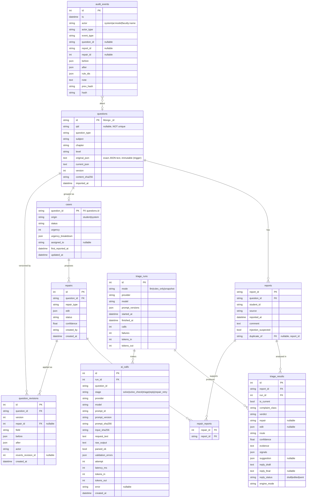

# Database Schema

SQLAlchemy 2.x models in `backend/app/models.py`. 

> **Database engine:** **SQLite is the primary, default, and existing database (`acadza.db`).** There is no migration to MySQL or PostgreSQL. All features, constraints, transactions, and audit integrity are built and verified natively on SQLite.

Datetime columns use `UTCDateTime`: naive UTC in the DB, timezone-aware in Python and the API (ADR-019). `cases.urgency`/`urgency_breakdown` are computed dynamically on read (ADR-020). Timestamps are ISO-8601 UTC. JSON columns use JSON serialisation.

## 1. SQLite Configuration & Storage Architecture
- **Engine URL:** `sqlite:///./acadza.db` (configured via `DATABASE_URL` in `config.py`).
- **Concurrency & WAL Mode:** Configured with `PRAGMA journal_mode = WAL;` (Write-Ahead Logging) to allow concurrent readers without blocking writes, and `PRAGMA synchronous = NORMAL;`.
- **Foreign Keys:** Enforced at connection time via `PRAGMA foreign_keys = ON;`.
- **Backup & Persistence:** On Render free-tier, the local container disk is ephemeral. The application achieves reliable initialization and recovery using `BOOT_IMPORT=true` (which imports original data with SHA-256 verification) and `BOOT_FROM_SNAPSHOT=true` (which restores triage decisions upon boot if the database is newly created). Standard SQLite `.db` file backups or snapshot exports (`artifacts/triage_snapshot.json`) provide offline recovery.

## 1. ER diagram

## 2. Enumerations

| Column | Values |
|---|---|
| `cases.status` | `untriaged` (after import, before triage), `needs_review, auto_pending` (auto-eligible, nothing applied; schema v2), `auto_fixed, no_change, approved, rejected, investigating, duplicate, rolled_back`. Triage may only change the machine-owned statuses `untriaged / needs_review / auto_pending / no_change`. |
| `repairs.status` | `proposed, auto_applied, approved_applied, approved_no_edit, rejected, rolled_back, superseded` |
| `triage_results.verdict` / `repair` | from `taxonomy.json` (validated in Pydantic and a CHECK constraint generated at create time) |
| `triage_results.route` | `auto_apply, faculty_review, no_change` |
| `audit_events.event_type` | (Phase 4 adds `triage_started, triage_decision, triage_completed, case_status_changed`) `report_received, triage_started, ai_call, ai_decision, validation_passed, validation_failed, scope_violation, auto_applied, faculty_approved, faculty_edited_proposal, faculty_rejected, investigation_requested, marked_duplicate, rolled_back, reply_edited, case_reopened, import_completed` |

`approved_no_edit` is used when faculty approves a repair that has no writable fields (diagram, wrong_chapter, …). It records "acknowledged; fix outside the system".

## 3. Indexes and constraints

- `reports(question_id)`, `reports(reported_at)`
- `triage_results(report_id) WHERE is_current` (app-enforced on SQLite)
- `cases(status, urgency DESC)` for the queue
- `audit_events(question_id, ts)`, `audit_events(event_type)`
- `question_revisions(question_id, version)` unique
- `ai_calls(run_id)`, `ai_calls(question_id)`
- **CHECK constraints** generated from `taxonomy.json`: verdict, repair, route, confidence ∈ [0,1], `repair IS NULL OR verdict = 'defect'` (R-02), statuses.
- **Triggers** (`backend/app/db.py`, SQLite `RAISE(ABORT)`):
  - `questions_original_immutable`: UPDATE OF original_json where the value changes → error.
  - `questions_no_delete`: DELETE prohibited on question records.
  - `audit_no_update`, `audit_no_delete`: Append-only audit integrity.
  - `revisions_no_update`, `revisions_no_delete` (rollback = a new revision).
- `meta(key, value)`: holds `schema_version` and the `data_sha256` fingerprint of the imported data.
- **Why TEXT for the record JSON:** it reproduces the source record exactly, and the immutability trigger compares plain text directly in SQLite. Tests assert `original == source` for all 43 records.

## 4. Audit hash chain

`hash = sha256(prev_hash || canonical_json(event without hash))`. The genesis `prev_hash` is 64 zeros. `GET /api/v1/audit/verify` walks the chain. This detects edits made outside the app (direct DB writes). It is not a defence against someone who can rewrite the whole table and recompute every hash. That limit is documented in SECURITY.md.

## 5. Migrations

There are no Alembic migrations for the MVP. At startup the app calls `Base.metadata.create_all()` and checks a `schema_version` row. If it doesn't match the app's expected version, it refuses to start with a clear message, and the fix is to delete the DB and re-import (seeded data, demo context). Alembic gets added the first time a real deployment needs to keep its data across a schema change.

## 6. Seeding

`scripts/import_data.py`: verify hashes → upsert questions (original_json = current_json = file content) → reports → create a case per reported question → `report_received` audit events. It is idempotent: re-running it on an imported DB is a no-op, apart from logging "already imported".

## 7. Schema version 2 (Phase 4)
- `cases.status` gains `auto_pending`.
- `triage_results` gains `inference`, `recommendation` and `review_reason` (TEXT). `signals` (JSON) holds the evidence list, key status and signals, confidence basis, student claim and correctness, rule IDs, history after the report, and the internal (possibly multi-field) edit.
- `SCHEMA_VERSION = "2"`: a v1 database refuses to start (delete and re-import, §5).

## 8. State transitions and revisions (Phase 5)
- **Repair lifecycle**: `proposed` → (`approved_applied` | `approved_no_edit` | `rejected`) → `auto_applied` (upon execution) → `rolled_back` (upon rollback).
- **Revision creation**: Executing an approved repair inserts a row in `question_revisions` and updates `current_json`, bumping `questions.version`. `original_json` remains untouched.
- **Rollback**: Restores the field to `before` by inserting a new revision with `reverts_revision_id` pointing to the reverted revision. Triggers prohibit any UPDATE or DELETE on `question_revisions`.
- **Case status sync**: Moves to `approved` when all repairs are approved, `rejected` when all repairs are rejected, `auto_fixed` when an approved repair is executed, or `rolled_back` when rolled back.
