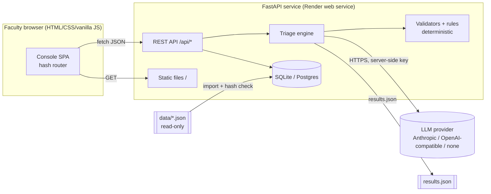
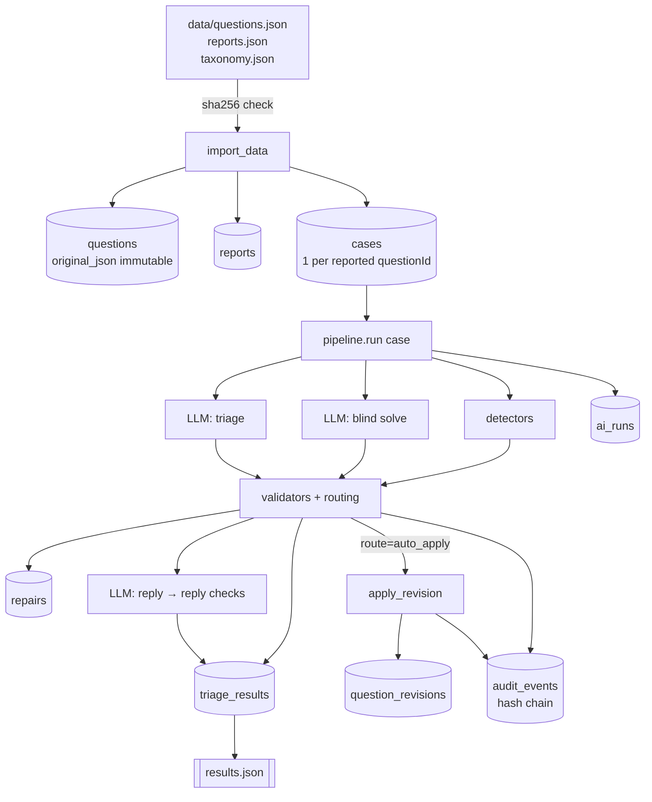
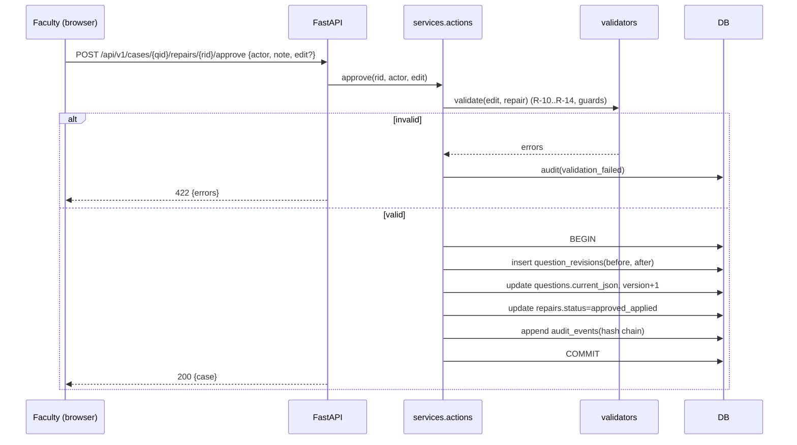
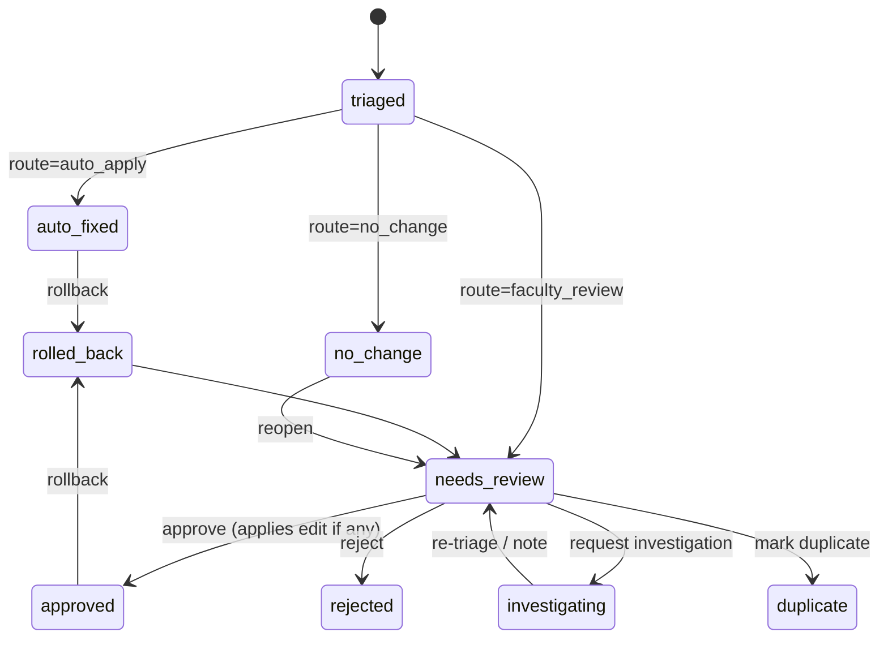
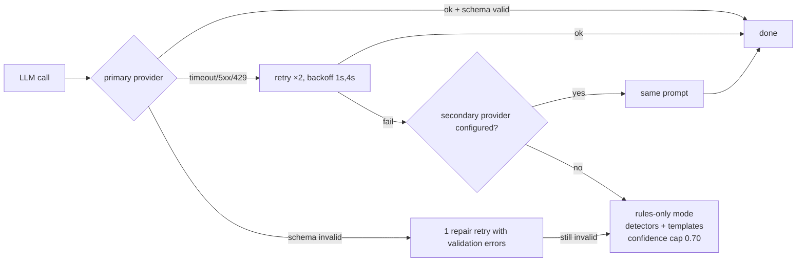
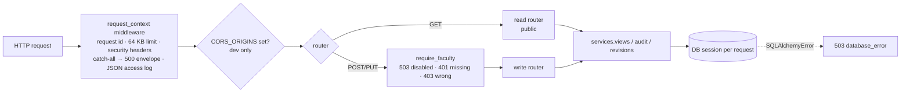

# System Architecture

## 1. Shape of the system

One deployable service. FastAPI serves both the REST API (`/api/*`) and the static vanilla-JS console (`/`). There is one database, selected by `DATABASE_URL`: SQLite locally, persistent PostgreSQL in production (ADR-015). The triage engine is a Python package inside the backend, usable two ways:

- **Batch:** `scripts/run_triage.py` processes all 44 reports and writes `results.json` plus the DB.
- **On demand:** `POST /api/v1/triage/run` re-triages one case (for example after a faculty "request investigation").



**Why one service:** a single Render free web service, no CORS in production, one thing to keep alive for 7 days. Frontend and backend are still separate code trees and talk only through REST (ADR-001).

## 2. Directory layout (planned)

```
acadza-report-fix/
  data/                    # original datasets, read-only
  docs/                    # this documentation
  backend/
    app/
      main.py              # app factory, lifespan, request middleware, logging   [built]
      sanitize.py          # nh3 allowlist for HTML + MathML                      [built]
      config.py            # env settings; postgres:// → postgresql+psycopg://    [built]
      db.py                # engine, session, dialect-specific guard triggers     [built]
      models.py            # SQLAlchemy tables, CHECKs from taxonomy              [built]
      taxonomy.py          # loads taxonomy.json, the only enum source            [built]
      importer.py          # hash check + strict schema validation + import       [built]
      schemas.py           # Pydantic API I/O                                     (Phase 3)
      api/                 # routes.py (read + write routers), deps.py (DB, faculty auth),
                           # errors.py (envelope)                                 [built]
      services/            # audit.py (hash chain), revisions.py (apply/rollback),
                           # views.py (read models, dashboard, urgency R-90)        [built]
      triage/
        pipeline.py        # stages 1-13
        html_parse.py      # HTML+MathML → structural linear text, option split   [built]
        record.py          # ParsedRecord, canonical answers, history_after       [built]
        complaints.py      # comment → class, claim, injection flag               [built]
        detectors.py       # structural facts per question                        [built]
        mathcheck.py       # safe evaluator, step checks, integer equations       [built]
        answers.py         # key check from the record's own solution             [built]
        engine.py          # rules-only decisions, calibration, routing, replies  [built]
        validators.py      # edit validity + mechanical repair guards             [built]
        output.py          # strict results / bonus schemas, writers              [built]
        detectors.py       # deterministic detectors (RULES §5)
        mathcheck.py       # safe AST numeric evaluator
        providers.py       # LLM provider adapters + fallback
        prompts/           # versioned prompt files (solve.v1.md, triage.v1.md, reply.v1.md)
        validators.py      # scope + repair guards (RULES R-10..R-42)
        routing.py         # confidence calibration + route (R-30, R-43)
        replies.py         # reply checks + templates (R-70..R-73)
    tests/
  frontend/
    index.html
    css/  (tokens.css, base.css, components.css, views.css)
    js/   (app.js, router.js, api.js, views/*.js, components/*.js, diff.js, render.js)
  scripts/ import_data.py, run_triage.py, validate_results.py                [built]
  results.json
  render.yaml
```

Dropped from the brief's suggested tree, with reasons in DECISIONS.md: a `repositories/` layer (the SQLAlchemy session already covers it, ADR-010), `frontend/pages/` (single page with hash routes, ADR-004), `seed_database.py` (same as `import_data.py`), and `evaluate_results.py` (no ground truth provided, ADR-012).

## 3. Data flow



## 4. Triage pipeline (13 stages)

The pipeline runs one case at a time (one question with all its reports), so the expensive LLM work is shared across duplicates: **39 cases instead of 44 reports**.

| # | Stage | Kind | Output |
|---|---|---|---|
| 1 | Normalise input | det | trimmed comment, language hint, `injection_suspected` |
| 2 | Associate report → question | det | FK check. A missing question means `not_actionable` plus a fault log entry. |
| 3 | Group duplicates | det | case = all reports with the same `questionId` |
| 4 | Extract content | det | `record.parse_record`: stem text, options `{A: html, text, blank}`, solution text, solution final value (advisory), canonical answer + format issues. MathML is linearised **structurally** (`(n q)/(2 ε_0)`), never tag-stripped. |
| 4b | History check | det | `record.history_after(question, reportedAt)`. A fix recorded after the report triggers a detector re-run and an `already_fixed` check **before** any repair is proposed (RULES R-24). |
| 5 | Detectors | det | list of findings (RULES §5) |
| 6 | Blind solve | **LLM** (`solve.v1`) | answer + working + `numeric_expr`. **No key, solution or comments given.** Skipped for pure-recall subjects only if the complaint is not about the answer. |
| 6b | Numeric check | det | safe-evaluate `numeric_expr`, match to option values |
| 7 | Classify + verdict | **LLM** (`triage.v1`) | per report: complaint class, verdict, candidate repair, candidate edit, evidence |
| 8 | Repair proposal | part of 7 | `edit` with `find` quoted from the raw field |
| 9 | Taxonomy validation | det | enum check (R-01, R-02) |
| 10 | Scope and guard validation | det | R-10 to R-14, R-31 to R-42 |
| 11 | Confidence and routing | det | R-21, R-30, R-43, R-44 |
| 12 | Student reply | **LLM** (`reply.v1`) + det check | reply consistent with the *final* route (R-71) |
| 13 | Persist and audit | det | triage_results, repairs, revisions, ai_runs, audit_events |

The 3 LLM calls per case give ~117 calls for the full dataset. See AI_ENGINE.md §8 for cost.

**Implemented today (rules-only, ADR-017/021):** stages 1–5, 8–11 and 13 are deterministic code. Stages 6–7 (blind solve, LLM triage) are replaced by the record-derived key check and complaint rules, and stage 12 by truthful reply templates. See AI_ENGINE.md §0.

## 5. Request lifecycle (faculty approves a proposal)



`find` must still match the current field at approval time (optimistic concurrency). If another revision changed it in between, the response is `409 Conflict`.

## 6. Faculty approval lifecycle



The case status is derived from its reports' results and repairs: the most action-requiring state wins.

## 7. Provider fallback



Every attempt is logged in `ai_runs`. A case processed in rules-only mode is labelled **"Rules-only (AI unavailable)"** in the console, and `engine_mode` records it internally. It is never presented as an AI result.

## 7b. API layer (implemented, Phase 3)



- **App factory** `create_app(settings, engine, clock)`: tests inject an in-memory engine and a fixed clock. Production uses env settings.
- **Lifespan:** create the engine from `DATABASE_URL`, run `init_db` (tables, triggers, schema guard), and if the DB is empty and `BOOT_IMPORT=true`, run the verified import. It logs a warning when writes are disabled.
- **Versioning:** everything is under `/api/v1`. OpenAPI is at `/api/v1/openapi.json`, the interactive reference at `/api/v1/reference`.
- **Read models** (`services/views.py`) are computed per request. Urgency is computed on read, so its `age` component is always current (ADR-020).
- **Timestamps:** `UTCDateTime` stores naive UTC and returns aware datetimes, so the API emits explicit `+00:00` (ADR-019).

## 8. Error handling

- API errors use one envelope, `{"error": {"code", "message", "details", "request_id"}}`, with `request_id` equal to the `X-Request-ID` header. Stack traces never reach the client. Codes are listed in API_SPECIFICATION §2. Unhandled exceptions are caught inside the request middleware so even a 500 keeps its request ID.
- Pipeline errors are isolated per case. One failing case never aborts the batch. That case gets `faculty_review` with evidence "automatic analysis failed: <code>".
- Startup aborts if the dataset hashes or the taxonomy don't load.

## 9. Security boundaries

| Boundary | Control |
|---|---|
| Browser → API | Pydantic validation, `extra="forbid"`, size limits, CORS same-origin in prod |
| Anyone → write endpoints | `X-Faculty-Key` must match server-side `FACULTY_ACCESS_KEY`; writes disabled if unset (RULES R-85, ADR-016). Reads public. |
| Student text → LLM | escaped JSON block, injection flag, no tool access (SECURITY.md) |
| LLM → DB | strict schema, taxonomy enums, scope guards, no route from LLM |
| Stored HTML → browser | server-side nh3 allowlist (HTML + MathML presentation tags). No `style`, `href`, `on*`, `annotation-xml` or `maction`. Stray MathML tags outside `<math>` are unwrapped first so content is never deleted (SECURITY §3). |
| Secrets | env only, never sent to the frontend, not in logs |

## 10. Scalability notes (beyond this assignment)

At 8 lakh questions the shape holds. The changes would be: a job queue (RQ/Celery) for triage instead of in-process, Postgres, batch blind-solves cached by `(question_id, content_hash)` so duplicate reports never re-solve, and per-subject solver prompts. The case-per-question grouping is what keeps LLM cost proportional to *broken questions*, not to *reports*.

## 11. Deployment

A Render web service runs `uvicorn backend.app.main:app` against a persistent free PostgreSQL (`DATABASE_URL`), and the health check is `GET /api/v1/health`. The first engine release runs in **rules-only mode** (ADR-017), and LLM providers plug in via env. On boot: if the DB is empty, import the data and load the committed triage snapshot `artifacts/triage_snapshot.json`, a superset of `results.json` that adds signals, suggestions, and ai_run summaries (ADR-011). No LLM credits are needed for the demo. Details and the free-tier persistence caveat are in DEPLOYMENT.md.
